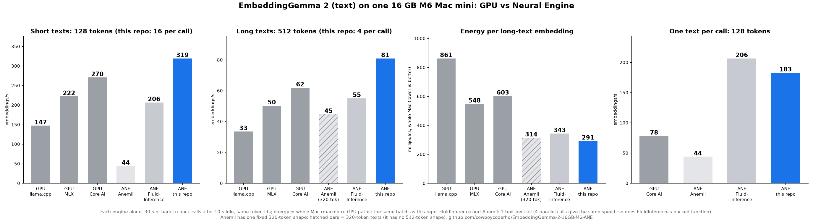

<h1 align="center">EmbeddingGemma 2 on the Neural Engine of a 16 GB M6 Mac</h1>

<p align="center">
  <sub>by <a href="https://x.com/CowboyCoderHQ">Cowboy Coder</a></sub>
  <br><br>
  <a href="https://x.com/CowboyCoderHQ"></a>
  <a href="https://huggingface.co/cowboycoderhq/EmbeddingGemma-2-FP16-M6-ANE"></a>
</p>

Run the text tower of [google/embeddinggemma-2](https://huggingface.co/google/embeddinggemma-2) on the **Apple Neural
Engine** of a 16 GB M6 Mac mini: **one Core AI file, FP16 weights, the whole model on the ANE, cosine 0.99998 to the
FP32 model**. Faster than every GPU path we measured on batches, at about half the energy per embedding. Three commands
to install, one to check that it works.

| | |
|---|---|
| Short texts (128 tokens, 16 per call) | **319 embeddings/s** on the ANE. Fastest GPU path: 270 (Core AI) |
| Long texts (512 tokens, 4 per call) | **81 embeddings/s** on the ANE. Fastest GPU path: 62 (Core AI) |
| One query at a time (128 tokens) | **183 embeddings/s** on the ANE. Core AI GPU: 78. FluidInference (ANE): 207 |
| Energy per long-text embedding, whole Mac | **291 mJ** on the ANE. GPU paths: 548–861 mJ |
| Power while embedding, whole Mac | **23.6 W** on the ANE (GPU at 0.1 W, idle). GPU paths: 27.5–37.3 W |
| Quality, cosine to FP32 (64 texts, 128 and 512 tokens) | **0.99998** mean, 0.99994 minimum |
| Quality, SciFact retrieval (nDCG@10) | **0.8543** on the ANE. FP32 reference: 0.8542 |
| Model size | 290 MB (FP16) + 268 MB token table, four input shapes in one file |



## Why the Neural Engine

On a Mac that runs a local LLM or an image model, the GPU is the busiest part of the machine. An embedding job for RAG
or search on the same GPU competes with it. The Neural Engine is a separate accelerator, and most of the time it does
nothing. On the M6 it also does the embedding work faster and with less power:

| Embedding job, 512 tokens x 4 | Embeddings/s | Whole-Mac power | Energy per embedding |
|---|---:|---:|---:|
| GPU, llama.cpp Q8_0 | 34 | 28.9 W | 861 mJ |
| GPU, MLX bf16 | 50 | 27.5 W | 548 mJ |
| GPU, Core AI (the same graph) | 62 | 37.3 W | 603 mJ |
| **ANE, this repo** | **81** | **23.6 W** | **291 mJ** |

A straight conversion does not get there. Four things push EmbeddingGemma 2 off the ANE or make it wrong on it:

| Trap | What happens | Fix in this repo |
|---|---|---|
| The token table (262,144 x 512) | A lookup this size does not belong on the ANE | Lookup on the host; the model takes token embeddings |
| FP16 range | The activations go far past what FP16 can hold, and a plain RMSNorm squares them | Residual / 8, every norm divides by its row maximum first, attention, MLP and per-layer-embedding outputs x16, x256, x16 before their norms. Exact in FP32 |
| FP16 subnormals | The ANE flushes values below about 6e-5 to zero. The same FP16 graph gives 0.999999 on the GPU and 0.99989 on the ANE. The per-layer embedding projection was the worst: its outputs peak at 0.05, and 1% of them were flushed | Projection weights x1024, and every norm divides by max / 8 so the values are in [-8, 8] before the square. Exact in FP32. Result: 0.99998 |
| A Core AI converter bug | A padding mask written as arithmetic + `permute` gives wrong attention whenever a batch has padding, on GPU and ANE | Mask built with `torch.where` |

Fix all four and rebuild the graph in the ANE's layout, (B, C, 1, S), 1x1 convolutions, one attention head at a time,
and the whole model runs on the ANE: in the Core AI runs the GPU stays at 0.1 W. The two Core AI problems are filed
upstream with repros: [apple/coreai-torch#137](https://github.com/apple/coreai-torch/issues/137) (mask),
[apple/coreai-torch#138](https://github.com/apple/coreai-torch/issues/138) (subnormals).

## Quick start

You need an Apple-silicon Mac with macOS 27 (tested: M6 Mac mini, 16 GB, macOS 27.0.1) and
[uv](https://docs.astral.sh/uv/) (or Python 3.11–3.13).

```bash
git clone https://github.com/cowboycoderhq/EmbeddingGemma-2-16GB-M6-ANE.git
cd EmbeddingGemma-2-16GB-M6-ANE
scripts/setup.sh          # .venv with numpy, tokenizers and the Core AI runtime (coreai-core)
scripts/download.sh       # model -> ~/Models/EmbeddingGemma-2-FP16-M6-ANE, every file checked against release.json
```

Check it on your Mac before you trust any number here:

```bash
.venv/bin/python -m eg2_ane.check quality ~/Models/EmbeddingGemma-2-FP16-M6-ANE   # cosine to FP32 -> QUALITY: PASS
.venv/bin/python -m eg2_ane.check speed   ~/Models/EmbeddingGemma-2-FP16-M6-ANE   # embeddings/s per input shape
```

The first load compiles the model for the Neural Engine (about 2 minutes). Later loads use the cache.

Use it:

```python
from eg2_ane.runtime import Embedder

emb = Embedder("~/Models/EmbeddingGemma-2-FP16-M6-ANE")
docs = emb.embed(["Mars is red because of iron oxide.", "Venus is the hottest planet."], prompt="document")
q = emb.embed(["Which planet is red?"], prompt="query")
print(docs @ q.T)    # [[0.795] [0.745]]: L2-normalized, so the dot product is the cosine
```

`prompt` takes the model's task prompts (`query`, `document`, `qa`, `fact`, `sts`, `classification`, `clustering`,
`code`) or any prefix string. For Matryoshka sizes, keep the first 512, 256 or 128 values and normalize again.

## What is in the box

| Path | What it does |
|---|---|
| `eg2_ane/model.py` | EmbeddingGemma 2 rebuilt for the ANE: layout, host-side lookup, FP16 scaling, the subnormal fixes, the mask fix |
| `eg2_ane/build.py` | PyTorch -> one `.aimodel` with four entry points and FP16 weights |
| `eg2_ane/runtime.py` | `Embedder`: tokenize like sentence-transformers, group by length, pick batch-1 or batched calls by time, run on the ANE (numpy + tokenizers + coreai-core only) |
| `eg2_ane/check.py` | `quality` (PASS/FAIL against FP32 reference embeddings) and `speed` |
| `eg2_ane/retrieval.py` | SciFact nDCG@10 for any engine, with the same token ids |
| `bench/` | The comparison: Core AI GPU, MLX, llama.cpp, FluidInference, energy from `macmon` |
| `tests/` | The rebuild equals sentence-transformers (FP32 cosine 0.9999999); the FP16 scales are exact; runtime tests |
| `results/` | Every number above, one JSON per engine and input shape |
| `model_card/` | The Hugging Face card, NOTICE, MODIFICATIONS.md |
| `CHANGELOG.md` | What is in each release, and what was measured and dropped |

### Entry points (input shapes)

| Name | Tokens | Texts per call | Use |
|---|---|---|---|
| `s128b1` | 128 | 1 | one short query, lowest latency (5.5 ms) |
| `s128b16` | 128 | 16 | indexing short texts, highest throughput |
| `s512b1` | 512 | 1 | one long document (19 ms) |
| `s512b4` | 512 | 4 | indexing long documents |

All four share one copy of the weights. Longer inputs are truncated to 512 tokens.

### Knobs

| Where | Knob | Values | Effect |
|---|---|---|---|
| `eg2_ane.build` | `--gelu` | `tanh` (default), `sigmoid2` | `sigmoid2` writes the same GELU with a sigmoid: cosine 0.999997 instead of 0.99998, about 11% slower |
| `eg2_ane.build` | `--entry` | `name=SEQxBATCH`, repeatable | the input shapes in the file (default: the four above) |
| `eg2_ane.build` | `--revision` | a commit of `google/embeddinggemma-2` | the weights to build from (default: the tested revision) |
| `Embedder` | `compute_unit` | `ane` (default), `gpu`, `cpu` | where Core AI runs the model |
| `Embedder.embed` | `prompt` | a task name or a prefix string | the EmbeddingGemma task prompt |

## Results

16 GB M6 Mac mini, macOS 27.0.1. Each engine alone, the same token ids, 30 s of back-to-back calls after 10 s idle.
Embeddings per second; energy is the whole Mac (`macmon` system power) averaged over the 30 s.

| Engine | 128 x 1 | 128 x 16 | 512 x 1 | 512 x 4 | Watts (512 x 4) | mJ per embedding (512) |
|---|---:|---:|---:|---:|---:|---:|
| GPU, llama.cpp `970b51c`, Q8_0, Metal | – | 147 | – | 34 | 28.9 | 861 |
| GPU, MLX 0.32.4, bf16 (mlx-vlm) | – | 222 | – | 50 | 27.5 | 548 |
| GPU, Core AI FP16 (the same graph) | 78 | 270 | 48 | 62 | 37.3 | 603 |
| ANE, FluidInference, Core ML FP16 | **207** | 207 | **55** | 55 | 18.9 (512 x 1) | 343 (512 x 1) |
| **ANE, this repo, FP16 (Core AI)** | 183 | **319** | 53 | **81** | **23.6** | **291** |

Against the fastest GPU path at each batched shape: 1.18x (128 x 16) and 1.31x (512 x 4) faster, 1.9x the work per
joule of MLX at 512 tokens. MLX does not catch up with larger batches: its best was 229 emb/s at 128 x 32 and 54 at
512 x 4 ([mlx-larger-batches.json](results/m6-release/mlx-larger-batches.json)). The Core AI GPU row is the faster of
two builds of the same graph.

For one text per call, [FluidInference](https://huggingface.co/FluidInference/embeddinggemma-2-coreml) is faster:
13% at 128 tokens, 4% at 512. It stays at 207 emb/s with 4 parallel requests and with its packed function, so on
batches this repo is 1.5x faster at 128 tokens and 1.47x at 512.

## Correctness

Cosine of each path to the FP32 sentence-transformers model (64 WikiText-2 texts):

| Path | 128 tokens, mean / min | 512 tokens, mean / min |
|---|---:|---:|
| **ANE, this repo** | **0.99998 / 0.99995** | **0.99998 / 0.99994** |
| ANE, this repo, `--gelu sigmoid2` | 0.999997 / 0.99999 | 0.999998 / 0.99999 |
| ANE, FluidInference (Core ML) | 0.99997 / 0.99993 | 0.99997 / 0.99988 |
| ANE, [Anemll](https://huggingface.co/anemll/anemll-embeddinggemma-2-ane) (Core AI, 320 tokens) | 0.99997 / 0.99991 | 0.99997 / 0.99986 (320) |
| GPU, MLX bf16 | 0.99994 / 0.99968 | 0.99995 / 0.99978 |
| GPU, llama.cpp Q8_0 | 0.99991 / 0.99955 | 0.99991 / 0.99971 |

Retrieval, SciFact (5,183 documents at 512 tokens, 300 queries at 128 tokens, nDCG@10): 0.8543 for this model, 0.8542
for FP32. Every engine we measured is within 0.0013 of FP32 ([results/m6-retrieval](results/m6-retrieval),
[results/m5-retrieval](results/m5-retrieval)).

How the subnormal fixes were found: run the same FP16 graph on the CPU, the Core AI GPU and the ANE. Only the ANE lost
precision, so the math and the conversion were fine. Then read intermediate outputs of the model and compare each with
FP32, with the maximum value next to the cosine: the first output that drops on the ANE and not on the GPU names the
op, and a maximum far below FP32's shows the flush.

## Build the model yourself

```bash
scripts/setup.sh --build                                   # .venv-build: + torch 2.14, coreai-torch 0.4.2, sentence-transformers 6.2
.venv-build/bin/python -m pytest -q tests                  # the rebuild equals sentence-transformers (11 tests)
.venv-build/bin/python -m eg2_ane.build ~/Models/EmbeddingGemma-2-FP16-M6-ANE   # about 1 minute on an M5 Max
```

The build reads `google/embeddinggemma-2` (Apache 2.0, no gate) at the revision in
[eg2_ane/common.py](eg2_ane/common.py). Pin the Core AI versions: coreai-torch 0.4.3 removed `AIProgram.optimize`.

## Limits

- Measured on one 16 GB M6 Mac mini, one 30 s run per engine and shape. Other Macs are not measured.
- Text only. The vision and audio towers are not converted (on the ANE they are slower than on the GPU in the
  FluidInference and Anemll measurements).
- 512 tokens maximum (EmbeddingGemma 2 supports 8,192).
- Fixed input shapes: three texts in the 16-text shape cost as much as sixteen. The runtime uses the batch-1 shape
  when that is faster.
- For one text at a time, FluidInference is faster (see Results).
- The ANE result is 0.99998 cosine to FP32, not bit-exact.
- Core AI is beta (coreai-core 1.0.0b2). The versions are pinned.

## Still on the table

- Batch 1: each call has a fixed cost of about 1 ms that FluidInference's Core ML path does not pay. Not yet found.
- Tried and dropped (all measured): INT8 weights (same speed, lower quality), all heads in one matmul per layer (10–22%
  slower in this graph), one fused per-layer-embedding projection (1–6% slower), an explicit softmax (no change).

## Credits and license

Built on Google DeepMind's EmbeddingGemma 2, Apple's Core AI and ml-ane-transformers, and ideas from FluidInference,
Anemll, ANEMLL Forge and eeANE. Details: [CREDITS.md](CREDITS.md). Independent project, not affiliated with or
endorsed by Google or Apple.

Code: MIT ([LICENSE](LICENSE)). The model files are a converted form of EmbeddingGemma 2 by Google DeepMind, under the
Apache License 2.0 ([NOTICE](NOTICE)). As the base model card states, deployments must adhere to the
[Gemma Prohibited Use Policy](https://ai.google.dev/gemma/prohibited_use_policy).
